# Decompositie Product- & Dienstenassortiment Woninginrichting (EasyM2M)

> **Doel van dit artefact:**  
> Dit document biedt de integrale en gedetailleerde boomstructuur (decompositie) van het product- en dienstenassortiment voor het **EasyM2M platform**, afgestemd op de werkwijze van moderne full-service woninginrichters (waaronder lanceerpartner *Groter in Wonen*, vestiging Gronsveld). Het vormt de taxonomische grondslag voor de configuratoren, digitale meetprotocollen, artikelstructuren en ERP-koppelingen (LogicTrade / AFAS / Unit4).
>
> **Scope & MVP-Kader:**  
> * **Assortimentsprofiel:** **Profiel A (Maatwerk Woningstoffering & Gevelsystemen, exclusief karpetten)**. Losse meubelen (banken, eethoeken, kasten), slaapcomfort (bedden/boxsprings) en losse karpetten vallen buiten de kern van deze configuratiescope.
> * **Status van Arbeid & Montage (Categorie 6):** Diensten, montage en logistiek behoren structureel tot de taxonomie en orderopbouw. **In de MVP van EasyM2M worden alle berekeningen m.b.t. arbeid handmatig ingevoerd en/of afgehandeld in het ERP-systeem (zoals LogicTrade/AFAS); geautomatiseerde arbeidsberekening is dus geen onderdeel van de EasyM2M MVP.**

---

## Overzicht van de 6 Categorieën (EasyM2M MVP)

```mermaid
graph TD
    Assortiment["Assortiment EasyM2M (Profiel A)"] --> C1["1. Gordijnen & Rails"]
    Assortiment --> C2["2. Raamdecoratie, Binnenzonwering<br/>& Horren"]
    Assortiment --> C3["3. Vaste Vloerbekleding<br/>& Dekvloertechniek"]
    Assortiment --> C4["4. Trapbekleding, Traprenovatie<br/>& Trapelementen"]
    Assortiment --> C5["5. Buitenzonwering, Gevelsystemen<br/>& Rolluiken"]
    Assortiment --> C6["6. Diensten, Montage & Logistiek<br/>(MVP: Handmatig / ERP)"]

    C1 --> C1_1["Stoffen, Confectie & Microflex"]
    C1 --> C1_2["Rails, Roedes, Interstil & Motoren"]

    C2 --> C2_1["Binnenzonwering (Duette, Plissé, Jaloezie, Shutters)"]
    C2 --> C2_2["Boorvrije Kaders (EasyClick/Perfect Fit) & Velux"]
    C2 --> C2_3["Horren (Inzet, Plissé hordeuren, Pollen/Petscreen)"]

    C3 --> C3_1["Harde Vloeren (Dryback/Click PVC, Laminaat, Parket, Gietvloer)"]
    C3 --> C3_2["Zachte & Elastische Vloeren (Tapijt, Vinyl, Marmoleum)"]
    C3 --> C3_3["Ondervloeren, CM-Vochtmeting & Coral Inloopzones"]

    C4 --> C4_1["Traprenovatie (PVC Overzettreden Synchroon Vloer)"]
    C4 --> C4_2["Open Trappen Contratreden & Trapstoffering Tapijt"]
    C4 --> C4_3["Trapleuningen met LED & Balustrades"]

    C5 --> C5_1["Rolluiken (Voorzet, Inbouw, Opbouw & SOLAR)"]
    C5 --> C5_2["Verticale Gevelscreens (Windklasse 6 & Valbeveiliging)"]
    C5 --> C5_3["Knikarmschermen, Markiezen & Lamellendaken"]

    C6 --> C6_1["Vloervoorbewerking, Schuren & Egalisatie"]
    C6 --> C6_2["Deurinspectie & Knelpuntenadvies (Geen Uitvoering)"]
    C6 --> C6_3["Hijsmaterieel (Ladderliften) & Afvalrecycling"]
```

---

## 1. Gordijnen & Rails

Gordijnen vormen een combinatie van textiele confectie, atelierarbeid en mechanische geleiding. Calculatie in ERP vereist strikte scheiding tussen couponmeters stof, confectieloon per baan en montagerails.

### 1.1 Stoffen & Textielsoorten
* **Transparanten & Vitrages:**
  * Zeer lichte, fijn geweven stoffen met maximale lichtdoorlaatbaarheid en dagprivacy (kamerhoog tot 300–320 cm of baanstof 140–150 cm).
* **In-betweens:**
  * Halftransparante stoffen, zwaarder dan vitrage, subtiele filtering van fel zonlicht en directe inkijk.
* **Dichte Stoffen (Overgordijnen):**
  * Zichtdicht textiel van linnen, katoen, wol, velours, chenille of gerecycled polyester.
* **Dim-out stoffen:**
  * 80% – 95% lichtdichtheid d.m.v. een zwarte weefkern tussen voor- en achterdoek (hotelkwaliteit, vlamvertragend Trevira CS).
* **Black-out stoffen (100% Verduisterend):**
  * 100% lichtblokkade door meerlaagse acrylaat- of PU-coating aan de achterzijde.
* **Voeringen & Tussenvoering:**
  * *Tussenvoering (Interlining):* Geruwde katoenen molton tussen hoofdstof en achtervoering; geeft body, isoleert thermisch en beschermt kwetsbare natuurvezels (zijde/linnen) tegen UV-degradatie.
  * *Akoestische Molton Tussenlaag:* Zware geluidsabsorberende molton (250–400 g/m²) ter reductie van nagalm ($\alpha_w \ge 0{,}65$).
  * *3-Pass Blackout Voering:* Los meegestikte verduisterende voering.

### 1.2 Plooitypes & Confectievormen
* **Wave-plooi:**
  * Vaste afstand tussen de runners via koordverbinding: **60 mm** (golfdiepte ca. 12 cm, min. 8 cm hart rail tot wand) of **80 mm** (golfdiepte ca. 16 cm, min. 10 cm hart rail tot wand). Gordijn hangt altijd symmetrisch onder de rail via ingenaaide wave-band.
* **Enkele plooi:**
  * Eén strakke vouw per runner; minimale stofinzet (factor 1,8× tot 2,0×), ideaal voor zware of stugge stoffen.
* **Dubbele plooi (Vlinderplooi):**
  * Twee vouwen per runner; klassieke, vollere valling (stofinzet factor 2,2× tot 2,5×). Industriestandaard bij in-betweens en overgordijnen.
* **Driedubbele plooi (Trioplooi):**
  * Drie vouwen per runner; zeer rijke plooivalling (factor 2,7× tot 3,0×), vooral bij soepele, dunne vitrages.
* **Retourplooi / Stolpplooi:**
  * Plooi die afwisselend naar voren en naar achteren vouwt; zorgt voor een compact pakket dat recht tussen muur en vensterbank blijft.
* **Microflex Verstelbare Haken:**
  * In de moderne confectie worden gordijnen voorzien van ingenaaide kunststof verstelbare haken (55 mm, 75 mm of 95 mm). Hiermee kan de stoffeerder op locatie de hoogte tot 3–5 cm fijn afstellen. Keuze uit *hoofdje boven rail* of *hoofdje onder rail* (bij plafondmontage en wave).
* **Onderzijde: Loodveter vs. Dubbele Zoom:**
  * *Loodveter (Loodsnoer):* Zink- of staalkoord (25–50 g/m) ingenaaid in een rolzoom bij vitrages en lichte in-betweens (loodvrij conform RoHS/REACH).
  * *Dubbele Onderzoom:* Standaard 8 cm, 10 cm of 12 cm hoog bij overgordijnen.
  * *Verzwaringsloodjes:* Rechthoekige gewichtjes (15–30 gram) ingenaaid in de hoeken van de zijzomen om het gordijn strak omlaag te trekken.

### 1.3 Rapportberekening & Snijverlies (ERP Wiskunde)
Bij dessin- en jacquardstoffen moeten patronen horizontaal exact doorlopen over alle banen:
$$\text{Knipmaat per baan } (K) = \text{Confectiehoogte} + \text{Zoomtoeslag Boven (10 cm)} + \text{Zoomtoeslag Onder (20 cm)}$$
$$\text{Aantal rapporten per baan } (N) = \left\lceil \frac{K}{\text{Verticaal Rapport } (V_r)} \right\rceil$$
$$\text{Bruto Bestelstof per baan} = N \times V_r$$
$$\text{Snijverlies per baan} = (N \times V_r) - K$$
*Bij een raam van 4 banen met een rapport van 64 cm bedraagt het snijafval gemiddeld 1,5 tot 2 meter extra bestelstof.*

### 1.4 Ophangsystemen (Rails, Roedes & Motoren)
* **Aluminium Gordijnrails:**
  * Smalle profielen voor wand-/plafondmontage (Forest KS/DS, Silent Gliss, Goelst). Bochtenwerk: 90° fabrieks- of machinebuiging, erkerbochten.
* **Railroedes (Design Hybrides):**
  * Esthetisch een roede (Interstil Sphinx/Codex/Integral, Silent Gliss Metropole in Ø 20, 25, 28, 30 mm of rechthoekig strak), maar intern voorzien van een loopkanaal waardoor glijders en wave-runners ongehinderd langs de tussensteunen glijden.
* **Klassieke Gordijnroedes:** Messing, RVS, matzwart staal met inslagringen (Ø 25 of 40 mm).
* **Embrasses & Trekstangen:** Gordijnophouders van stof, leder of metaal; acrylaat of metalen trekstangen (75–150 cm) ter voorkoming van vette vingers op kwetsbaar textiel.
* **Gemotoriseerde & Smart-Home Rails:**
  * Somfy Glydea Ultra (230V netvoeding of oplaadbare Li-ion accu met RTS / io-homecontrol).
  * Forest Shuttle (met RJ12 potentiaalvrij contact voor KNX/Crestron domotica en RF).
  * MotionBlinds / Eve (Matter-over-Thread: directe Apple HomeKit / Google Home integratie zonder bridge).

---

## 2. Raamdecoratie (Binnenzonwering & Horren)

Mechanische maatwerkproducten berekend via een fabrieksmatrix ($\text{breedte} \times \text{hoogte}$) en gemonteerd *in de dag* of *op de dag*.

### 2.1 Binnenzonwering Productgroepen
* **Plissé & Duette® (Honingraatplissé):**
  * *Enkele plissé:* Gevouwen stof in zigzagvorm.
  * *Duette® Dubbele Cel:* 25 mm, 32 mm of 64 mm celbreedte; stilstaande isolerende luchtlaag en verborgen spankoorden (geen lichtlichter).
  * *Modellen:* Top-Down / Bottom-Up (vrij verschuifbaar), Dag & Nacht (duo-systeem: transparante stof boven, 100% verduisterende honingraatstof onder in één systeem).
* **Rolgordijnen & Duo-Rolgordijnen (Zebra / Twist):**
  * Standaard rol op aluminium as, cassette met U-profiel zijgeleiders (100% verduisterend), duo-rolgordijnen met afwisselend transparante en dichte banen.
* **Horizontale Jaloezieën:**
  * *Hout:* Lamellen 25, 50, 65 mm (Abachi, Basswood, bamboe); ladderkoord of ladderband (10, 25, 38 mm).
  * *Aluminium:* Lamellen 16, 25, 35, 50 mm; vochtbestendig, met Megaview® optie voor dubbel doorzicht.
* **Verticale Lamellen (Lamellengordijnen):** Textiel, aluminium of kunststof (PVC) banen van 89 of 127 mm breed (zeer geschikt voor schuine ramen).
* **Vouwgordijnen (Roman Shades):** Segmenterend textiel met baleinen (voor- of achterzijde); optioneel gevoerd.
* **Shutters (Binnenluiken):** Massief houten (Basswood) of vochtbestendige polywood luiken met kantelbare lamellen in een montageframe; scharnierend, vouwend of op railschuifsystemen.

### 2.2 Dakraamsystemen & Speciale Vormen
* **Dakraamcassettes:** 100% pasvorm op fabriekscodes van **Velux** (bijv. GGL MK04), **Fakro** en **Roto**; met borstelafdichting en spandraden die de stof onder dakhelling strak houden.
* **Afwijkende Kozijnvormen:** Driehoeksramen (Slope), trapezium- en toogramen (rondboog/waaiers); ingemeten d.m.v. mallen en hoekberekeningen.

### 2.3 Boorvrije Montagesystemen (Kozijngarantie)
Schroeven in moderne kunststof of aluminium kozijnen met thermische isolatiekamers leidt direct tot **verval van fabrieks- en lekgarantie**.
* **EasyClick / FrameFix / Splendid Pliss:** Magnetisch aluminium montagekader waarin de raamdecoratie is voorgemonteerd; klikt naadloos vast op zelfklevende staalband in de glaslat.
* **Perfect Fit (Louvolite):** 4-delig aluminium frame dat d.m.v. platte klemsteunen achter het glasrubber wordt geschoven.
* **Klemsteunen Draaikiepraam:** RVS/kunststof klemhaakjes om de overslag van de raamvleugel.

### 2.4 Horren & Insectenwering
* **Inzethorren:** Klemconstructie met RVS verenstaal voor draaikiepramen (boren overbodig).
* **Voorzet- & Rolhorren:** Vaste kaders met wervels of cassette met windvaste borstelgeleiders.
* **Plissé Hordeuren:** Horizontaal inschuivend geplooid gaas met rupsketting over een ultradunne 3 mm drempelstrip; leverbaar als dubbele hordeur met magneetsluiting voor openslaande deuren (tot 3800 mm).
* **Gespecialiseerde Gaassoorten:**
  * *Pollengaas (Poll-tex®):* Elektrostatisch gaas met ECARF-certificaat (>97% pollenwering).
  * *Petscreen:* Zwaar polyester gaas met PVC-coating (7x sterker, kattenklauwbestendig).
  * *ClearView:* Extra dunne vezels met 20% beter doorzicht en luchtstroom.

---

## 3. Vaste Vloerbekleding & Dekvloertechniek

Vloeroplossingen vereisen strikte bouwfysische schouw van de ondervloer en conformiteit met NEN-EN normen.

### 3.1 Harde & Minerale Vloeren
* **Dryback PVC (Plak-PVC / LVT):** Dikte 2,0–2,5 mm, slijtlaag 0,55 mm (projectklasse). Volledig verlijmd op geëgaliseerde ondergrond. Patronen: Rechte stroken, visgraat, walvisgraat (XXL), Hongaarse punt (45°/60°), tegelmotieven met accentbies.
* **Click-PVC / Rigid Core (SPC):** Dikte 4,5–7,0 mm met minerale tussenlaag en geïntegreerde kurk- of IXPE-onderlaag. Zwevend geklikt.
* **Laminaat:** HDF-drager met melamine toplaag (gebruiksklasse 31, 32, 33); waterbestendige klikverbinding.
* **Parket & Multiplank (Lamelparket):** Multiplex drager met eiken toplaag (3–6 mm); behandeld met olie, hardwax of lak.
* **PU-Gietvloeren & Woonbeton:** Scheuroverbruggend taai-elastisch polyurethaan of minerale gietvloer (Arturo, Cemart).

### 3.2 Zachte & Elastische Vloeren
* **Kamerbreed Tapijt:** Rolbreedtes 400 of 500 cm; polyamide (PA), wol, sisal of gerecycled Econyl; vol verlijmd of gespannen op latten.
* **Tapijttegels:** Modulaire tegels (50 × 50 cm) met bitumen- of viltrug.
* **Vinyl / Novilon:** Rollen van 200, 300 of 400 cm breed met verende schuimrug.
* **Marmoleum / Linoleum:** Duurzaam natuurproduct van Forbo (rolbreedte 200 cm); naden thermisch gelast met lasdraad.

### 3.3 Bouwfysische Vochtmetingen & Normen (NEN-EN 13813 / NEN 2741)
* **Carbidmethode (CM-Meting):** De enige juridisch bindende vochtmeting bij geschillen. Monstername onderin de dekvloer met calciumcarbid in stalen drukcilinder conform **NEN 2741**.
  * *Zandcementdekvloer:* max. **2,0 CM-%** (zonder vloerverwarming) / max. **1,5 CM-%** (met vloerverwarming).
  * *Anhydrietdekvloer:* max. **0,5 CM-%** (zonder vloerverwarming) / max. **0,3 CM-%** (met vloerverwarming).
* **Epoxy Vochtbarrière:** 2K epoxy primer (bijv. Eurocol 021 / Uzin PE 460) kruislings aangebracht bij restvocht tot 4 CM-%, afgestrooid met vuurgedroogd kwartszand.

### 3.4 Dilatatiewetgeving & Entreezonering
* **Dilataties:** Verplicht bij zwevende vloeren > 40 m² (laminaat) of > 100 m² (SPC), lengtes > 8–10 meter, en in alle deuropeningen tussen afzonderlijke vertrekken.
* **Entreezonering (Forbo Coral / Emco):** Minimaal 1,5 tot 2 meter inloopzone; noodzakelijk voor garantiebehoud op harde vloeren. Geplaatst in een aluminium inbouwputrandprofiel op exact gelijke hoogte.
* **Vloerbescherming:** Scratch no More viltglijders met droogloopvezel (geen vuilhechting) ter voorkoming van krassen door stoelen.

---

## 4. Trapbekleding, Traprenovatie & Trapelementen

Specialistische discipline waarbij geometrie, veiligheid, slijtweerstand en akoestiek samenkomen.

### 4.1 Trapconstructie & Geometrie
* **Trapvormen:** Rechte steektrap, trap met 1 kwart (boven- of onderkwart met verdreven treden), trap met 2 kwarten / bordestrap / spiltrap.
* **Dichte Trap:** Treden sluiten aan op stootborden.
* **Open Trap:** Rondom zichtbaar; vereist **contratreden** aan de onderzijde in dezelfde kleur als de boventrede, inclusief U-omkapping van de neuzen.

### 4.2 Traprenovatie met Overzettreden
* **Systeemopbouw:** Overzettreden met geïntegreerde neus (L-profiel) verlijmd over bestaande treden.
* **Materialen:**
  * *PVC / SPC Overzettreden:* Slijtlaag 0,55 mm, geluiddempend, antislip, identiek doorlopend aan het PVC-decor van de begane grondvloer (o.a. Belakos, COREtec, Trenovo).
  * *CPL / HPL Laminaat:* Krasvast met aluminiumoxide toplaag.
  * *Massief Eiken:* Onbehandelde toplaag, af te werken met 2K olie in gewenste kleur.
* **Onderdelen per Trede:** Overzettredekern, stootbord (vloerkleur, RAL 9010, matzwart), uitlooptrede naar overloop, trapwangen (zijkanten).
* **Montagelijmen:** Elastische High Tack MS-polymeer (Zwaluw / Mamut) en 2K PU bruisschuim voor holle treden (voorkomt permanent kraken).
* **Veiligheid & Verlichting:** Ingefreesde antislip rubberen T-strips of carborundumkorrels; LED-strips gefreesd onder de trede-neuzen met bewegingssensoren boven en onder.

### 4.3 Trapstoffering met Tapijt & Traplopers
* **Rondom Stoffering:** Tapijt strak om treden en stootborden gespannen en verlijmd over rubber ondertapijt.
* **Traplopers:** Tapijtbaan in het midden van de trap; zijkanten geschilderd in het zicht. Afgewerkt met katoenen bandering (5 of 8 cm) of festonnering; vastgezet met messing/chroom/zwarte loperroedes en kniegewricht-klemmen.

### 4.4 Balustrades & Trapleuningen
* Trapleuningen in eikenhout, matzwart staal of RVS (rond Ø 42/45 mm of rechthoekig blokprofiel) met optioneel geïntegreerde diffuse LED-lijn aan de onderzijde.
* Balustrades met stalen spijlen (RAL 9005) of gehard glazen panelen voor overloop en vide.

---

## 5. Buitenzonwering, Gevelsystemen & Rolluiken

Exterieure systemen ter wering van oververhitting en inbraak vóórdat zonnestraling het glas binnendringt.

### 5.1 Rolluiken (Voorzet-, Opbouw-, Inbouw- & Solar-systemen)
* **Kastuitvoeringen:** 45° afgeschuind, half-rond of rond (maten 137, 150, 165, 180, 205 mm).
* **Voorzetrolluiken:** Buitenmontage op de gevel of op het kozijn.
* **Opbouw- & Inbouwrolluiken:** Kast voorgemonteerd op het kozijn of verzonken in de spouwmuur.
* **Solar Rolluiken (Dé Markttrend):** Monokristallijn zonnepaneel op de kast, interne LiFePO4 accu en 12V DC buismotor (Somfy Oximo Solar io / Brel). **Voordeel:** Nul geveldoorboringen, geen 230V stroomaansluiting, 100% autonome werking.
* **Lamelprofielen:** Dubbelwandig gerold aluminium gevuld met isolerend PU-schuim (Heroal RS 37/42, Alulux CD 142) of geëxtrudeerd aluminium; inbraakwerend gecertificeerd conform **RC2 / RC3 (NEN-EN 1627)** met optilbeveiliging.

### 5.2 Verticale Gevelscreens
* **Ritsscreens (Zip / Fixscreen):** Doek met aangelaste rits in kunststof geleideprofielen; windvast tot windkracht 10–12 Beaufort (**Windklasse 6 conform NEN-EN 13561**) en fungeert tevens als hor.
* **Valbeveiligingsscreens:** Screens gecombineerd met Frans balkon doorvalbeveiliging conform **NEN-EN 1991-1-1 / NEN 2608** voor verdiepingshoge ramen.
* **Doektypes:** Glasvezel (Sergé) of polyester (Soltis) met openheidsfactoren van 1%, 3% of 5%.

### 5.3 Horizontale Zonwering & Knikarmschermen
* **Knikarmschermen (Terrasschermen):** Twee zware knikarmen met staalkabels of smeedijzeren kettingen (uitval tot 3,5–4,0 meter). Uitvoering in open, semi-cassette of volledig gesloten cassette. Windklasse 2 conform **NEN-EN 13561**.
* **Uitvalschermen & Markiezen:** Uitvalarmen voor ramen zonder looproute; authentieke markiezen in hout of aluminium.

### 5.4 Buitenleven & Overkappingen
* **Verandazonwering:** Onderdak- of bovendakzonwering op spanning via gasveer- of veersystemen over glazen overkappingen.
* **Lamellendaken:** Aluminium constructies met kantelbare waterdichte lamellen en geïntegreerde hemelwaterafvoer (Brustor B200).
* **Glaswanden & Terrasverwarming:** Meersporen glazen schuifwanden (10 mm ESG) en infraroodstralers (IR-A 1500–2500W, Bromic/Solamagic).

---

## 6. Diensten, Montage & Montagelogistiek (Domein III)

> **Belangrijke MVP-Bepaling:**  
> Diensten en montage maken een wezenlijk onderdeel uit van de orderstructuur bij woninginrichters. **In de MVP van EasyM2M worden alle berekeningen m.b.t. arbeid handmatig ingevoerd en/of afgehandeld in het ERP-systeem (LogicTrade / AFAS). Geautomatiseerde arbeidsberekening is dus geen onderdeel van de EasyM2M MVP.**  
> De onderstaande structuur dient als taxonomische standaard voor orderregels, werkbonnen en data-uitwisseling.

### 6.1 Sloop- & Voorbereidende Werkzaamheden
* **Oude Vloeren Verwijderen:** Losliggend vs. vol verlijmd tapijt strippen met professionele stripper; parket of plavuizen slopen en afvoeren per $\text{m}^2$ of containerforfait.
* **Ondergrond Bewerken:** Diamantfrezen van lijmresten; schuren van calciumsulfaat sinterlagen bij anhydriet; industrieel fijnstofzuigen (H-klasse).
* **Meubelverplaatsing:** Regietarief of forfait per vertrek voor het verplaatsen van zware meubels.

### 6.2 Egalisatie & Vloertechniek
* **Egalisatieparameters:** Laagdikte (standaard 2–3 mm vs. renovatielagen > 10 mm), primer en egalineverbruik ($1{,}6\ \text{kg/m}^2/\text{mm}$, afgerond op zakken à 25 kg).
* **Vochtbarrière Aanbrengen:** Aanbrengen 2K epoxy vochtscherm met kwartszand instrooien.

### 6.3 Deurinspectie & Beleid Deuren Inkorten (Strikte Taakafbakening)
* Doordat een nieuwe vloeropbouw het peil met 5 tot 15 mm kan verhogen, kunnen binnendeuren gaan klemmen op de vloer of dorpels.
* **Strikte Taakafbakening (Geen Uitvoering door Stoffeerders):** Conform de operationele beleidslijn van lanceerpartner *Groter in Wonen* (vestiging Gronsveld, zie ook domeinmodel §3.4.5) voeren eigen stoffeerders en vloerenleggers **definitief géén zaag- of schaafwerkzaamheden aan binnendeuren** meer uit. Dit beleid is ingesteld wegens substantiële aansprakelijkheids- en schaderisico's (zoals het splijten van kwetsbaar fineer, constructiebreuk bij honingraatdeuren of beschadiging van stalen stabilisatiestaven in kamerhoge deuren).
* **Inmeetprocedure & Adviesrol:** Bij speling < 4 mm tussen de toekomstige vloerhoogte en de onderkant van de deur registreert de technisch inmeter het knelpunt op het inmeetverslag:
  * Type deur: **opdekdeur** (paumelles, opdekrand) vs. **stompe deur** (insteekscharnieren).
  * Gemeten speling en benodigde inkorting (in mm).
  * Status: *Signalerend adviespunt* ten behoeve van de aannemer, timmerman of opdrachtgever. De klant draagt zelf de verantwoordelijkheid voor het tijdig laten inkorten en opnieuw afhangen van de deuren vóór de vloerinstallatie.

### 6.4 Verticaal Transport & Hijsmiddelen
* **Ladderlift / Verhuislift:** Inzet bij lange railprofielen, brede rollen tapijt of gevelzonwering op verdiepingen; tarief per dagdeel incl. gecertificeerde bediener.
* **Rolsteiger / Hoogwerker:** Conform Arbowetgeving bij gevelmontage boven 2,5 meter werkhoogte.
* **Logistiek:** Postcode-staffels voorrijkosten en milieu-recyclingbijdrage (Cradle-to-Cradle scheiding van PVC-snijafval).

---

## Samenvatting: Typologieën, Reken- & Meeteenheden

| Categorie | Primaire Calculatie-eenheid | Primaire Inmeet-dimensies | Belangrijkste Validatieparameters | ERP Verpakkingsgovernance |
| :--- | :--- | :--- | :--- | :--- |
| **1. Gordijnen & Rails** | Strekkende meter rail + Baanmeters stof | Railbreedte (mm), Plafond-tot-vloerhoogte (mm) | Rapportgrootte, plooifactor, wave-diepte (60/80mm), vrijloop radiator, Microflex haakpositie | Stof afronden op rapportveelvoud; fournituren per doos/rol |
| **2. Raamdecoratie & Horren** | Stuks (uit fabrieksmatrix B $\times$ H) | Dagmaat breedte & hoogte (3-puntsmeting, mm) | In/op de dag, haaksheid, klembereik EasyClick, Velux typecode, kindveiligheid NEN-EN 13120 | Stuks product; toeslagen voor schunie modellen |
| **3. Vaste Vloeren** | $\text{m}^2$ netto oppervlakte | Lengte $\times$ Breedte (mm) per vertrek | Vochtmeting (CM-%), vlakheidsklasse, dilataties >40/100m², warmteweerstand $R_c \le 0{,}15$ | Dwingend afronden op **volle pakken**; egaline per zak 25 kg |
| **4. Trapbekleding** | Stuks treden + Sets overzettreden | Aantal treden, tredebreedte, loopdiepte | Open/Dicht, trapvorm (recht/1-kwart/2-kwart), uitlooptrede, LED-frezing, trapleuningen | Rechte treden per 4 stuks; verdreven treden per paar |
| **5. Buitenzonwering & Rolluiken** | Stuks (breedte $\times$ uitval/hoogte) | Gevelbreedte (mm), Uitval/Hoogte (mm) | Spouwanker M12, 230V vs Solar LiFePO4, windklasse NEN-EN 13561, valbeveiliging NEN 2608 | Stuks assemblage; hijskraan/ladderlift per dagdeel |
| **6. Diensten & Montage** | MVP: Handmatig / ERP-delegatie | Te bewerken oppervlakten en stuks deuren | Vloersloop, egalisatiedikte (mm), deurenadvies (stuks knelpunten), ladderlift per dagdeel | Handmatige orderregels in MVP gekoppeld aan ERP |

---
*Gevalideerd en geconsolideerd ten behoeve van het EasyM2M Architectuur- en Calculatieplatform (MVP Scope).*
